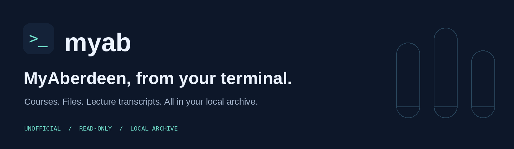
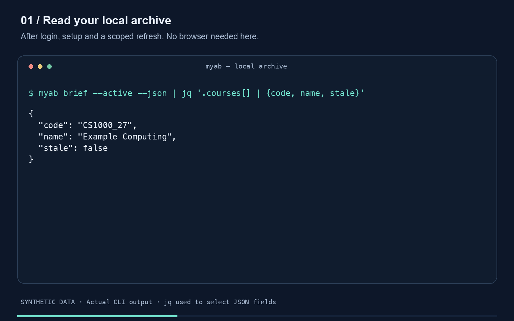
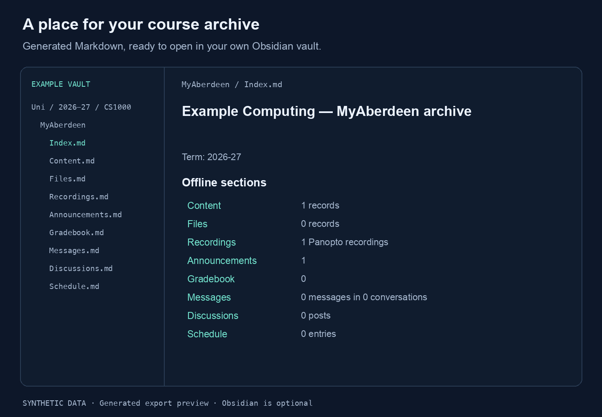

<p align="center">
  
</p>

# MyAberdeen CLI

**Your courses, files and lecture transcripts. Archived locally. Available from your terminal.**

An unofficial, read-only client for the University of Aberdeen's Blackboard Learn site. Sign in through Chrome, select your courses, then keep an archive you can query offline.

[](https://github.com/jacobcorbett/myaberdeen-cli/releases/latest)
[](https://github.com/jacobcorbett/myaberdeen-cli/actions/workflows/check.yml)
[](LICENSE)

[Download](https://github.com/jacobcorbett/myaberdeen-cli/releases/latest) · [Quick start](#quick-start) · [Documentation](#documentation) · [Changelog](CHANGELOG.md)

## A look inside

[](docs/media/terminal-demo.mp4)

**[Watch the 30-second demo](docs/media/terminal-demo.mp4)** · [Animated version](docs/media/terminal-demo.gif) · [Text walkthrough](docs/demo.md)

The demo uses actual CLI output from a synthetic local archive after setup and refresh. The first two examples use `jq` to select JSON fields; `jq` is optional and is not required by the CLI. The static preview above stays still until you choose to play.

## What you can do

| Bring it into your archive | Use it on your own terms |
| --- | --- |
| Course content, announcements and available grades, messages and schedules | Read local briefs and inspect individual records without opening Chrome. |
| Ordinary course files | Download incrementally, verify hashes and retain changed versions. |
| Accessible Panopto recordings and captions | Search saved transcripts, follow timestamped links and explicitly download permitted videos. |
| JSON, extracted text and generated Markdown | Query with scripts or an AI assistant, and optionally export into Obsidian. |

Completed test reviews are archived during scoped `check`, `sync` and `refresh`: question text, answer options and your responses, plus any feedback Blackboard releases. Read them offline with `myab test-reviews --course CODE --format text`. See [test review coverage and limits](docs/usage.md#completed-test-reviews).

Panopto is opt-in. Linked/searchable recordings do not guarantee a complete folder inventory, and available grades or schedules do not guarantee a complete assessment calendar.

## Quick start

You need **Google Chrome** and your own University of Aberdeen account. Portable downloads include Node; no separate Node or npm installation is needed.

1. **[Download the release for your computer](https://github.com/jacobcorbett/myaberdeen-cli/releases/latest)** and extract the entire folder. Keep `lib/` beside the launcher.
2. **Sign in** with `myab login` and complete your university sign-in/MFA in the dedicated Chrome window.
3. **Choose your courses** with `myab setup`. Leave the optional vault path blank if you do not use Obsidian.
4. **Create your archive** with `myab check --active`. Use `myab refresh --active` when you also want course files downloaded.
5. **Read it offline** with `myab brief --active`, or run `myab doctor` for setup checks.

Here `myab` means the installed command. In an extracted portable folder, use `./myab` on macOS/Linux or `.\myab.cmd` on Windows. Add the whole extracted folder to `PATH` to use `myab` elsewhere.

| Computer | Download suffix | Try it after extracting |
| --- | --- | --- |
| Mac with Apple Silicon | `macos-arm64.tar.gz` | `./myab help` |
| Linux x64 | `linux-x64.tar.gz` | `./myab help` |
| Windows x64 | `windows-x64.zip` | `.\myab.cmd help` |

Read the [installation guide](docs/installation.md) for checksum verification, OS security prompts, source installation and updates. Source installs require Node **26.13.0 or newer within Node 26**. Refreshes run on demand; the CLI does not install a background schedule.

## Your archive, in Obsidian



*Generated Markdown preview using synthetic data; this is an illustration of the export, not a screenshot of the Obsidian app.*

Obsidian is optional. If you use it, configure your own vault containing a `Uni` directory, then preview the merge:

```sh
myab export --active
myab merge-vault --active --dry-run
```

After reviewing the plan, run `myab merge-vault --active --keep-duplicates` to generate the notes while retaining raw duplicates. Course indexes link to files, recordings and offline transcripts. Keep personal notes separate from generated files. See [Exports and Obsidian](docs/obsidian.md) for configuration, ownership and duplicate handling.

## Use it with an AI assistant

The repository includes a portable [MyAberdeen CLI skill](skills/myaberdeen-cli/SKILL.md). Give an assistant the repository URL and ask it to read that file for installation, scoped refreshes and archive-first questions.

> Read `skills/myaberdeen-cli/SKILL.md`, help me install the CLI and sign in, then configure only the courses I select.

The skill contains no account data and does not require the author's personal vault. See [skill installation and updates](docs/installation.md#ai-agent-skill-and-updates) for details.

## Authentication and privacy

Sign-in uses a dedicated private Chrome profile. Login makes session-only cookies persistent for up to seven days; university expiry, revocation and MFA rules still apply. Chrome uses `--password-store=basic` and `--use-mock-keychain`, so do not assume those cookies have normal OS keychain protection.

Use a trusted personal account, keep the profile private, and do not share or sync it. Downloaded materials and exports can contain grades, messages and other people's information; choose a suitable private location and review your backup settings. Read [Authentication and local data](docs/authentication.md) before signing in, including how to stop local session reuse.

This project is not affiliated with or endorsed by the University of Aberdeen, Anthology/Blackboard or Panopto. Use only your own authorised access and respect institutional rules and course-content permissions. The software licence does not cover downloaded university materials.

## Documentation

| Guide | What's inside |
| --- | --- |
| [Installation and updates](docs/installation.md) | Portable downloads, checksums, source setup, AI skill and upgrades. |
| [Using your archive](docs/usage.md) | Course selection, commands, freshness, integrity, extraction, relocation, paths and exit codes. |
| [Panopto recordings](docs/panopto.md) | Scoped discovery, captions, transcript search, exports and permitted downloads. |
| [Exports and Obsidian](docs/obsidian.md) | Vault configuration, merge previews and generated-note ownership. |
| [Authentication and local data](docs/authentication.md) | Session persistence, profile protection, privacy and sign-out. |
| [Development and releases](docs/development.md) | Checks, portable builds and release publishing. |
| [Demo and artwork](docs/demo.md) | Accessible text walkthrough, synthetic fixture and media regeneration. |

## Contributing, licence and security

Open an issue first, then work in your own fork and submit a pull request for Jacob to review. See [CONTRIBUTING.md](CONTRIBUTING.md) for the workflow and checks.

Copyright © 2026 Jacob Corbett. Released under the [MIT licence](LICENSE); redistributed copies or substantial portions must retain the copyright and licence notices. Contributions are accepted under the same licence. Report security issues through the private routes in [SECURITY.md](SECURITY.md).
