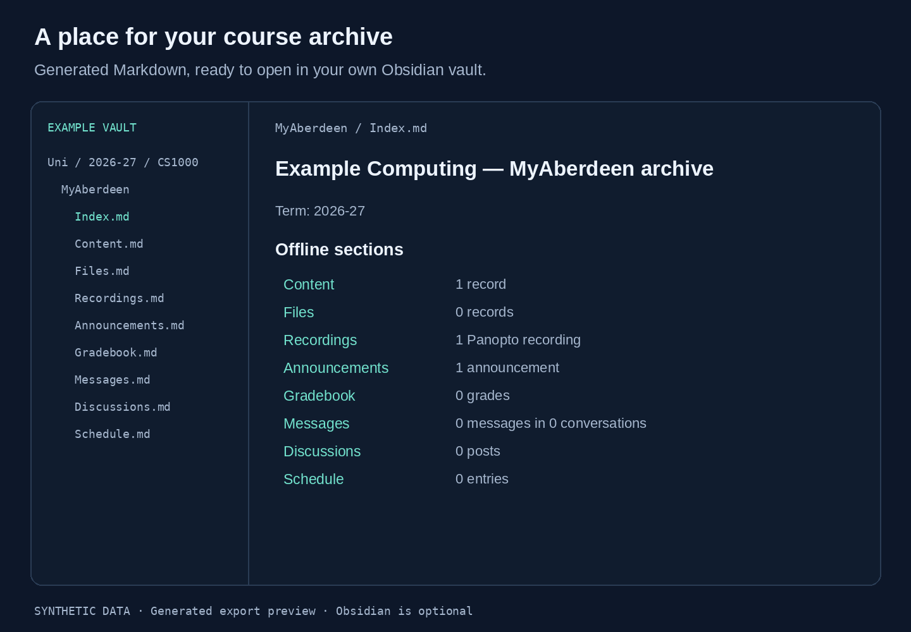

# Demo and artwork

[← Back to the README](../README.md)

[Watch the MP4](media/terminal-demo.mp4) · [Animated GIF](media/terminal-demo.gif) · [Static preview](media/terminal-demo.png)

## What the demo shows

This 30-second, silent demo uses actual CLI output from a synthetic archive. It begins **after** the normal login, course selection and scoped refresh; it does not demonstrate live sign-in, network performance or a real university account. Every course, recording and transcript is fictional. Synthetic recording links are placeholders, not playable university recordings.

The commands run against a temporary local SQLite archive. Nothing reads your existing configuration, Chrome profile, archive or Obsidian vault. No network calls or browser sessions are needed. The archive and generated vault are removed after capture.

The first two scenes pipe JSON through `jq` for readability. Install `jq` if you want to copy those exact pipelines; the CLI itself does not require it. Run the command before `| jq` to see the full JSON response.

## Read your local archive

After login, setup and a scoped refresh. No browser needed here.

```sh
myab brief --active --json | jq '.courses[] | {code, name, stale}'
```

```json
{
  "code": "CS1000_27",
  "name": "Example Computing",
  "stale": false
}
```

## Find a moment in a lecture

Search the captions already saved in your archive.

```sh
myab recordings --course CS1000_27 --search "byte" |
  jq '.[] | {title, matches: [.matches[] | {start, text}]}'
```

```json
{
  "title": "How computers represent information",
  "matches": [
    {
      "start": 12,
      "text": "Eight bits form a byte, giving 256 possible combinations."
    }
  ]
}
```

## Read the transcript offline

Caption timestamps stay attached to the text.

```sh
myab transcript --course CS1000_27 \
  --id 11111111-1111-1111-1111-111111111111
```

```text
[00:00:00.000] Welcome. Today we will look at binary representation.
[00:00:05.000] A bit can hold one of two values: zero or one.
[00:00:12.000] Eight bits form a byte, giving 256 possible combinations.
[00:00:20.000] We can use those patterns to represent numbers and text.
```

## Obsidian export preview



The preview renders section labels and counts from an actual generated `Index.md`. It is an illustration of the Markdown export, not a screenshot of Obsidian. Machine-specific paths and internal metadata are omitted from the image. The full synthetic index and transcript are inspectable in [demo.json](media/demo.json); the `/demo` paths there are placeholders.

## Regenerate the media

From a **source checkout** with its npm dependencies installed, use Node 26.13.0 or newer within Node 26, Python 3 with Pillow 13, `jq` and FFmpeg with `libx264`:

```sh
node scripts/readme-fixture.mjs
python3 scripts/render-readme.py
```

Pillow is an authoring dependency only; install it in your own Python environment if needed. No production dependency or normal CLI installation needs these media tools. The renderer uses local Arial/Menlo fonts on macOS, or on Linux Liberation Sans (Arial-compatible metrics) with DejaVu Sans Mono, falling back to DejaVu Sans. Set `MYAB_MEDIA_FONT` and `MYAB_MEDIA_MONO` to font files on other systems. Different font versions can change pixels; CLI output and scene timings remain reproducible.

The renderer creates the banner, the export preview, a terminal poster, a 30-second H.264 MP4 and a looping GIF. It uses temporary frame files, cleans them up and leaves no servers or browser processes. All artwork is original geometric artwork generated by the script, with no university logo, stock photography or external image service. Project artwork and synthetic examples use the repository's MIT licence.

The README uses a still poster linked to the MP4 so it does not autoplay. The GIF is an optional animated alternative. The text walkthrough above provides the same commands and output without motion or video.
